# Alur Sistem dan User Flow Ayomi

Link User Flow : https://www.figma.com/board/Bhrj4DhI8bNIlc7gB36gSW/User-Flow-Ayomi?node-id=875-1085&t=FVADJmT2O44Ecn6o-1

Isi dokumen:
1. Arsitektur sistem
2. Peran dan hak akses
3. User flow per peran
4. Mesin status (pendaftaran, insiden, komplain)
5. Pipeline fitur AI
6. Data, privasi, dan keamanan

---

## 1. Arsitektur sistem

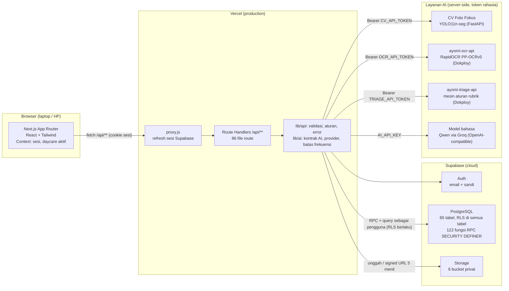

**Poin penting untuk presentasi:**
- **Browser tidak pernah memanggil layanan AI langsung.** Semua kunci (`*_TOKEN`, `AI_API_KEY`) hanya ada di env server Vercel, tidak memakai awalan `NEXT_PUBLIC_`.
- **Aplikasi tidak memakai `service_role`.** Setiap query berjalan sebagai pengguna yang login, jadi RLS dan pemeriksaan peran di fungsi SQL selalu berlaku.
- **Logika bisnis terpisah dari route.** Route Handler hanya membungkus `lib/api/*`. Validasi, error, dan pemanggilan RPC ada di `lib/`.

## 2. Peran dan hak akses

| Peran | Cara mendapat akun | Portal | Hak utama |
| --- | --- | --- | --- |
| Tamu | — | `/`, `/pencarian`, `/detail/[id]`, `/bandingkan` | Membaca katalog publik |
| **Orang Tua** | Daftar sendiri (`/daftar`) + konfirmasi email | `/beranda` dan menu Orang Tua | Data anak, pendaftaran, pembayaran, catatan harian, laporan, komplain, ulasan |
| **Pengasuh** | Undangan Pengelola + verifikasi Admin | `/pengelola` (menu Pengasuh) | Catatan harian dan foto anak yang **sedang ditugaskan**, laporan insiden |
| **Pengelola** | Undangan Admin saat mitra dibuat | `/pengelola` (menu lengkap) | Pendaftaran, penugasan, staf, dokumen, profil dan harga, ulasan, insiden daycare-nya |
| **Admin** | Dikelola internal | `/admin` | Verifikasi (dokumen, harga, foto, pengasuh), pembayaran, moderasi, Safety Score, eskalasi |

## 3. User flow

### 3.1 Orang Tua: dari mencari sampai memantau

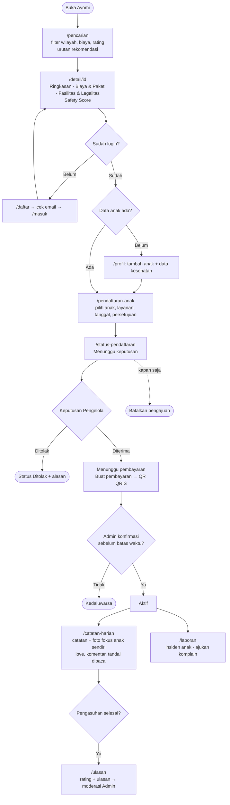

### 3.2 Pengasuh: catatan harian dengan dua AI

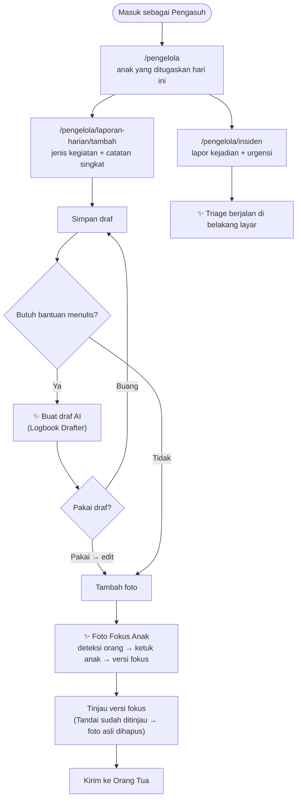

### 3.3 Pengelola: operasional daycare

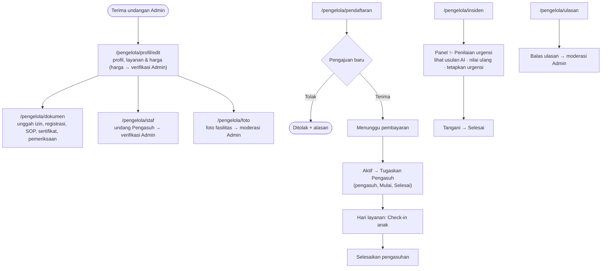

### 3.4 Admin: verifikasi dan kendali

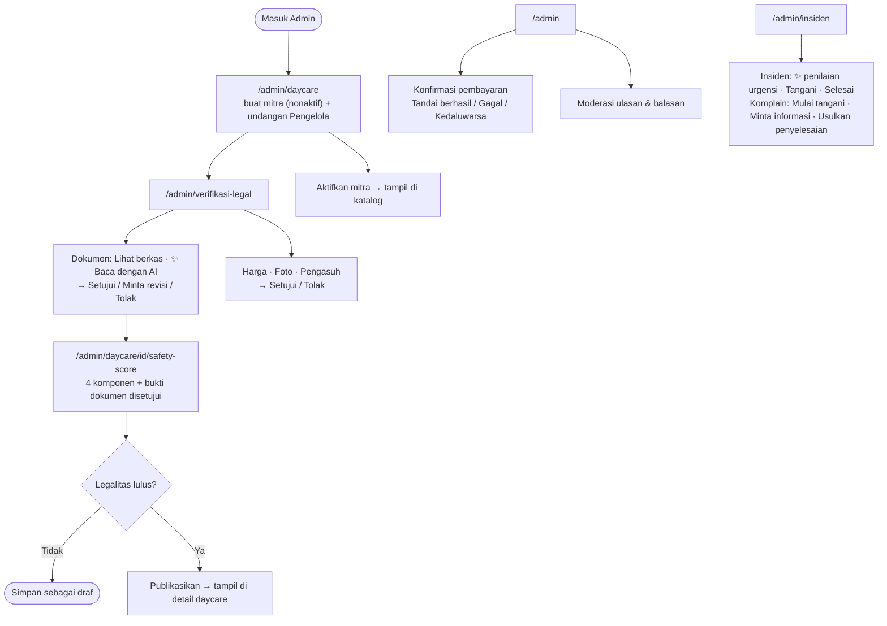

### 3.5 Skenario lintas peran (untuk demo dan UAT)

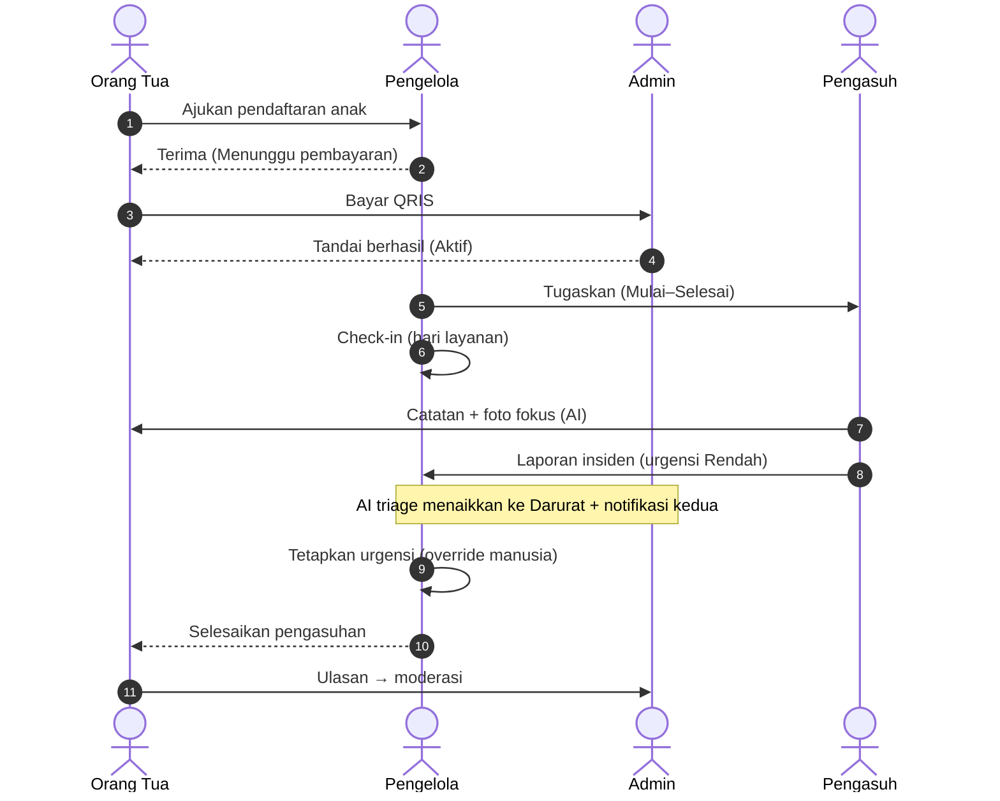

## 4. Mesin status

### 4.1 Pendaftaran (`enrollments.status`)

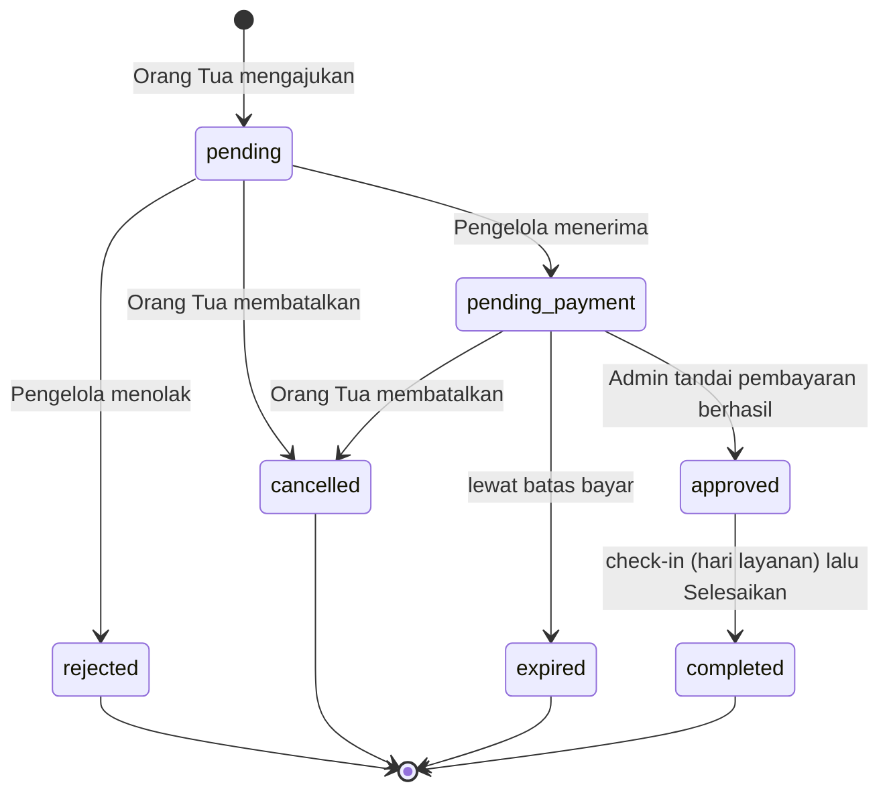

Label di aplikasi: pending = **Menunggu keputusan**, pending_payment = **Menunggu pembayaran**, approved = **Aktif**, completed = **Selesai**.

### 4.2 Insiden dan urgensi

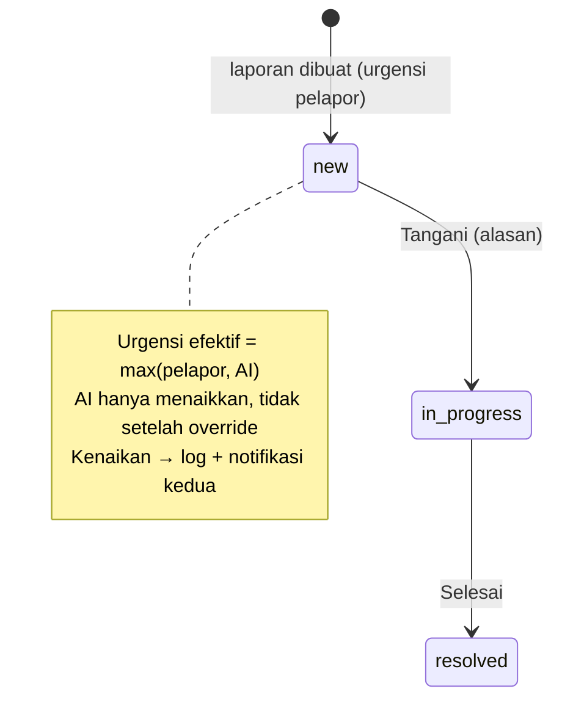

### 4.3 Komplain

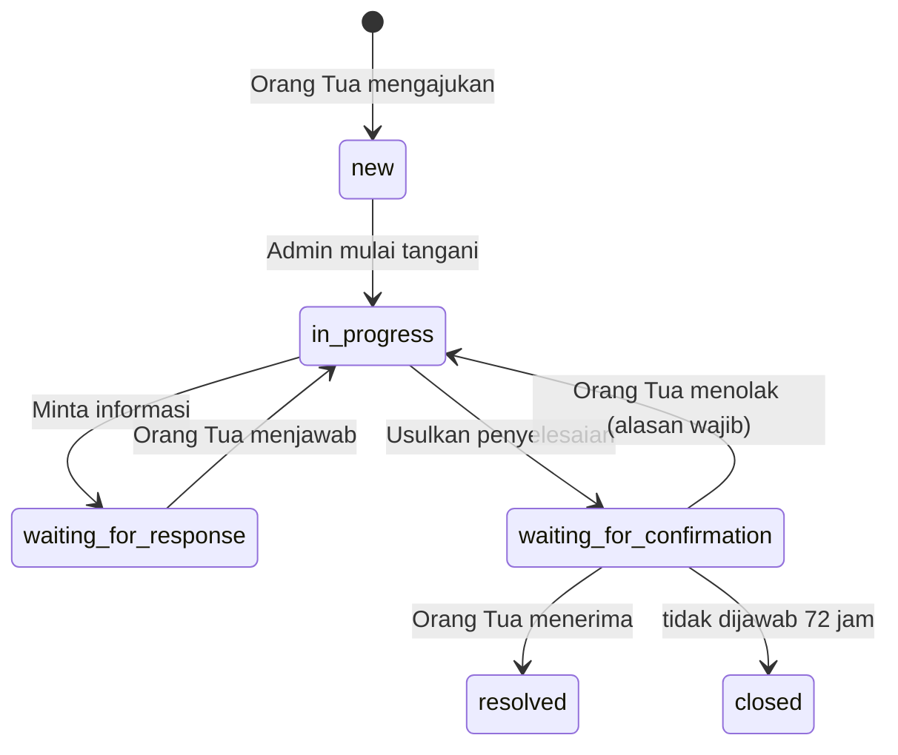

## 5. Pipeline fitur AI

### 5.1 Foto Fokus Anak (Computer Vision)

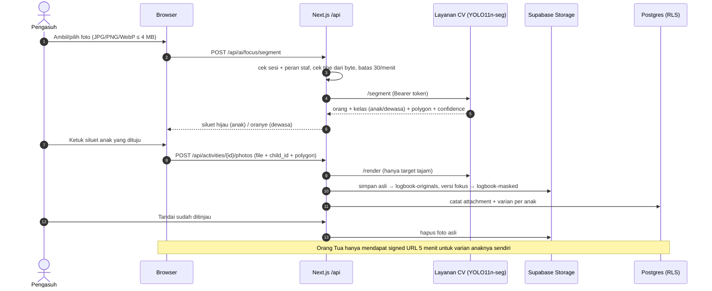

### 5.2 Draf Catatan Harian (Logbook Drafter)

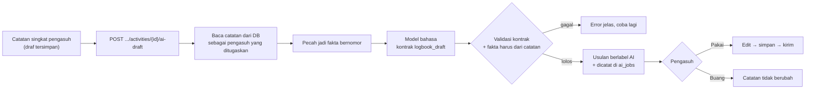

### 5.3 Baca Dokumen Legalitas (OCR + model bahasa)

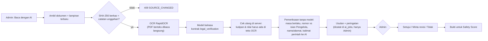

### 5.4 Penilaian Urgensi Insiden (Triage)

```mermaid
sequenceDiagram
  autonumber
  actor R as Pelapor
  participant API as POST /api/incidents
  participant DB as Postgres
  participant T as ayomi-triage-api
  R->>API: uraian, pertolongan pertama, urgensi pelapor
  API->>DB: simpan laporan + notifikasi awal
  API-->>R: 201 (pelapor tidak menunggu AI)
  API->>DB: after(): ambil teks + usia anak (tanpa nama/tgl lahir)
  API->>T: /triage + rubrik draf-1 (Bearer)
  T-->>API: urgensi usulan + kutipan + informasi kurang
  API->>API: validasi kontrak (kutipan harus dari laporan)
  API->>DB: app_record_incident_triage
  DB->>DB: efektif = max(pelapor, AI); naik → log + notifikasi Pengelola & Admin
  Note over DB: Gagal/timeout → hanya dicatat di ai_jobs, urgensi pelapor tetap
```

### 5.5 Safety Score (rumus, bukan model)

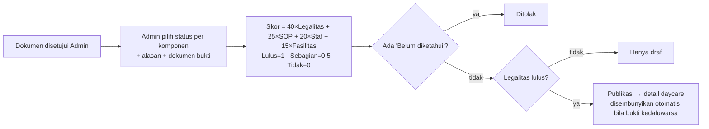

### 5.6 Rekomendasi di pencarian (rule-based weighted scoring)

`lib/daycare-directory.js` → `recommendationScore`:
- Daycare **mitra** Ayomi: skor 100.
- Daycare katalog: skor dihitung dari tiga bobot, lalu dijumlah:
  - legalitas: terdaftar 20, sedang ditinjau 5;
  - rating × 2;
  - jumlah fasilitas (maksimal 6) × 0,5.
- Filter wilayah, biaya, dan rating, serta pengurutan, dijalankan di **server** (`/api/daycares`).

## 6. Data, privasi, dan keamanan (ringkas untuk slide)

| Aspek | Penerapan |
| --- | --- |
| Data anak ke AI | Triage hanya menerima uraian dan usia dalam bulan, **tanpa nama dan tanggal lahir**. Foto, dokumen, dan laporan dikirim ke layanan AI milik tim sendiri (CV, OCR, triage), bukan ke pihak ketiga. Hanya teks catatan dan teks OCR yang dikirim ke model bahasa (Groq). Kebijakan penyimpanan di layanan CV perlu dicek tim CV sebelum ditulis di slide |
| Foto anak | Orang Tua hanya melihat varian anaknya sendiri lewat signed URL 5 menit. Foto asli dihapus setelah ditinjau |
| Penanda AI | Semua hasil AI berlabel "Dibuat AI" atau menyebut mesinnya |
| Human-in-the-loop | Draf AI, OCR, dan triage semuanya usulan. Keputusan tetap di tangan Pengasuh, Admin, dan Pengelola |
| Kunci | Hanya di env server. Riwayat git sudah dipindai dan bersih |
| Akses data | RLS di 65 tabel, 122 fungsi berhak-penuh yang dikunci, 6 bucket privat |
| Batas penggunaan AI | 6–30 permintaan per menit per akun. Input dibatasi ukuran dan tipenya |
