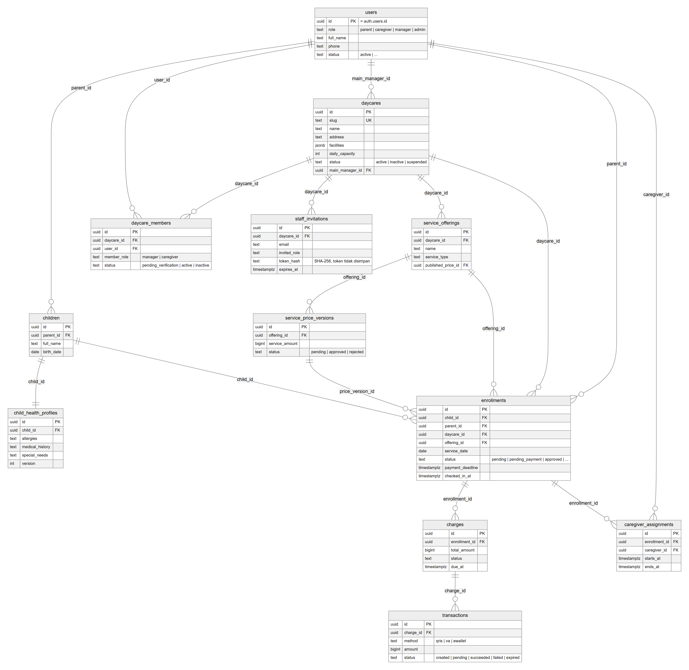
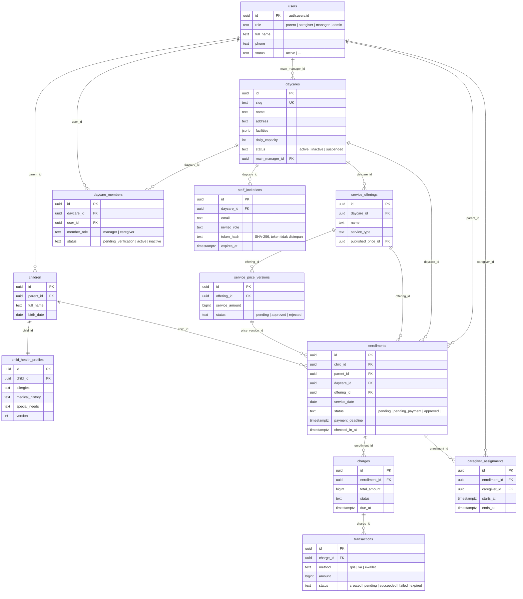
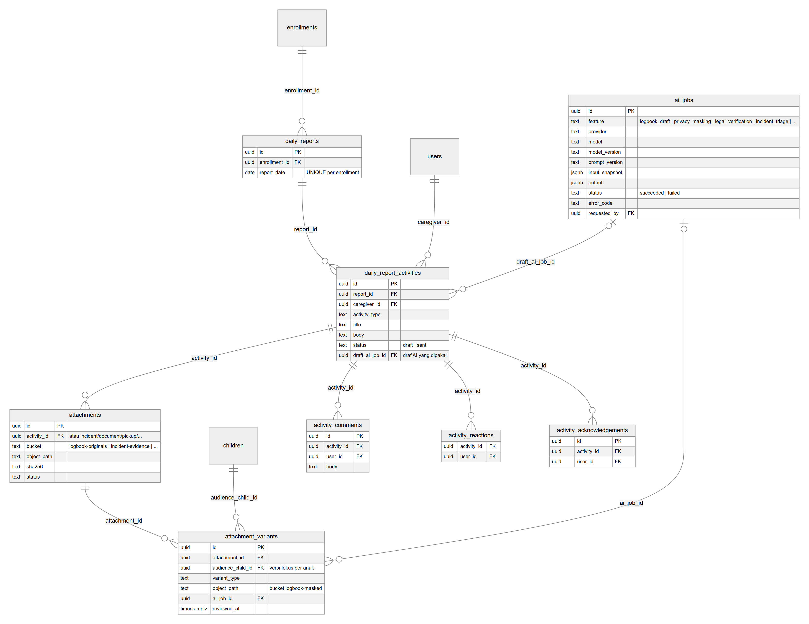
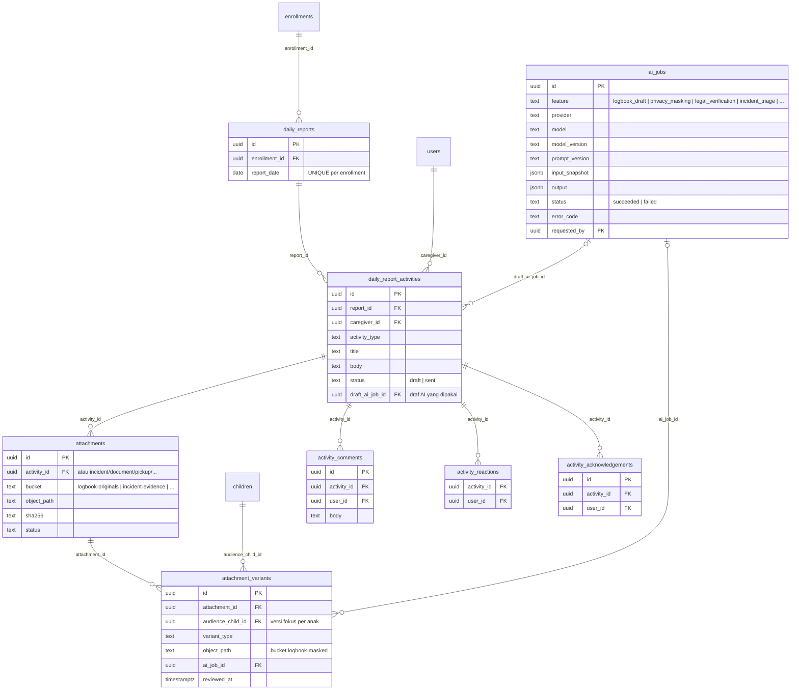
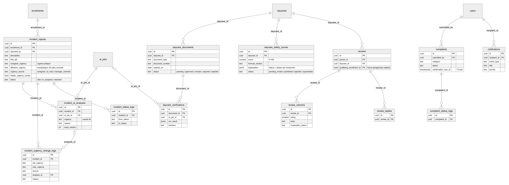
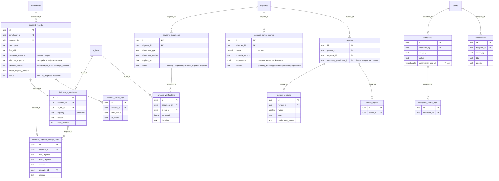

# ERD / Schema Diagram Ayomi

Database Ayomi berjalan di **Supabase PostgreSQL**: **66 tabel**, **194 relasi foreign key**, dan RLS aktif di semua tabel.

**Sumber skema (diambil dari Supabase):**
- `supabase/schema/live_schema_snapshot.sql`: snapshot skema yang diambil **langsung dari database Supabase production** lewat `pg_catalog` (tabel, constraint, index, policy, fungsi, hak akses);
- `supabase/migrations/*.sql`: perubahan setelah snapshot, misalnya tabel `daycare_photos`.

Diagram di folder ini dibuat dari kedua sumber itu, jadi sama dengan database production. `database/001_create_tables.sql` adalah rancangan awal dan sudah berbeda di beberapa bagian (misalnya kunci tabel `children` adalah `child_id`).

## Isi folder ini

| Berkas | Isi |
| --- | --- |
| `erd.md` (halaman ini) | 3 diagram **inti** yang menunjukkan alur utama, daftar 66 tabel per domain, dan catatan desain |
| [`erd-per-domain.md`](erd-per-domain.md) | 13 diagram, satu per domain, dengan **semua kolom** setiap tabel. Dibuat otomatis dari skrip SQL |
| [`schema.dbml`](schema.dbml) | Seluruh skema dalam format DBML. Buka di [dbdiagram.io](https://dbdiagram.io): **Import → DBML**, lalu tempel isi berkas untuk diagram interaktif yang bisa digeser dan diperbesar |
| `gambar/` | PNG semua diagram, siap dipakai di deck |

Untuk membuat ulang `erd-per-domain.md` dan `schema.dbml` setelah skema berubah: `node scripts/generate-erd.mjs`.

**Mengambil ERD langsung dari Supabase:** buka Supabase Dashboard → **Database → Schema Visualizer**. Halaman itu menggambar semua tabel dan relasi dari database production. Karena ada 66 tabel, diagramnya sangat lebar, jadi lebih mudah dibaca per bagian (perbesar lalu screenshot) atau lewat diagram per domain di folder ini.

Notasi: `||--o{` artinya satu ke banyak. PK = primary key, FK = foreign key.

## 1. Akun, daycare, pendaftaran, dan pembayaran

## 2. Catatan harian, media, dan data AI

## 3. Insiden, verifikasi, Safety Score, ulasan, dan komplain

## 4. Daftar lengkap 66 tabel per domain

Diagram lengkap setiap domain (semua kolom) ada di [`erd-per-domain.md`](erd-per-domain.md).

| Domain | Tabel |
| --- | --- |
| Akun & peran | `users`, `daycare_members`, `staff_invitations`, `daycare_delegations`, `delegation_permissions`, `account_sanctions` |
| Daycare & katalog | `daycares`, `daycare_listings`, `daycare_listing_profiles`, `daycare_photos`, `service_offerings`, `service_price_versions`, `commission_rules` |
| Anak | `children`, `child_health_profiles`, `child_health_change_logs`, `child_health_correction_requests` |
| Pendaftaran | `enrollments`, `enrollment_service_dates`, `enrollment_consents`, `enrollment_status_logs`, `caregiver_assignments` |
| Pembayaran | `charges`, `transactions`, `payment_details`, `payment_webhook_events`, `refunds`, `financial_holds`, `payouts`, `payout_items`, `daycare_payout_accounts`, `payout_account_change_requests` |
| Catatan harian | `daily_reports`, `daily_report_activities`, `activity_comments`, `activity_reactions`, `activity_acknowledgements`, `report_change_logs` |
| Media | `attachments`, `attachment_variants` |
| Penjemputan | `authorized_pickups`, `pickup_records` |
| Insiden | `incident_reports`, `incident_ai_analyses`, `incident_urgency_change_logs`, `incident_status_logs`, `incident_parent_acknowledgements` |
| Legalitas & Safety Score | `daycare_documents`, `daycare_verifications`, `daycare_safety_scores` |
| Ulasan | `reviews`, `review_versions`, `review_replies`, `review_reply_versions` |
| Komplain & investigasi | `complaints`, `complaint_status_logs`, `complaint_assignments`, `investigations`, `admin_actions` |
| Notifikasi | `notifications`, `notification_receipts`, `notification_reminders`, `notification_delivery_logs` |
| AI | `ai_jobs` (semua fitur), plus tabel hasil per fitur: `incident_ai_analyses`, `daycare_verifications`, `attachment_variants` |
| Sistem & audit | `system_settings`, `audit_logs` |

## 5. Catatan desain (untuk penjelasan juri)

**Normalisasi:**
- Harga disimpan per versi (`service_price_versions`), tagihan per pendaftaran (`charges`), dan transaksi per percobaan bayar (`transactions`).
- Ulasan dan balasan juga berversi (`*_versions`) supaya riwayat moderasi tidak tertimpa.

**Riwayat tidak dihapus:**
- Foreign key memakai `ON DELETE RESTRICT`.
- Perubahan penting dicatat di tabel `*_logs` dan `audit_logs`.

**Constraint:**
- `NOT NULL`, `CHECK` untuk status dan enum, `UNIQUE` (misalnya satu `daily_reports` per pendaftaran per tanggal);
- rentang waktu penugasan tidak boleh tumpang tindih;
- kolom `version` untuk penguncian optimistis.

**Data AI:** setiap pemanggilan AI tercatat di `ai_jobs` (model, versi prompt, input, output, status, error). Hasil per fitur ditaruh di tabel domainnya:

| Fitur | Tabel hasil |
| --- | --- |
| Triage | `incident_ai_analyses` |
| OCR | `daycare_verifications` |
| Foto Fokus | `attachment_variants` |
| Draf catatan | `daily_report_activities.draft_ai_job_id` |

**Keamanan:**
- RLS aktif di **semua 66 tabel**.
- Tulis dan baca lewat fungsi RPC `SECURITY DEFINER` yang memeriksa peran. Hak `EXECUTE` dicabut dari `anon` kecuali 7 fungsi katalog publik.
- Storage memakai 6 bucket privat dengan kebijakan per folder.

**Script dan seed** (kriteria 14):
- skema: `database/001_create_tables.sql` dan `supabase/migrations/`;
- seed katalog: `supabase/seed/daycare_listings_seed.sql` dan `daycare_listing_profiles_seed.sql`;
- akun demo: `scripts/import-demo-daycare-accounts.mjs`.
